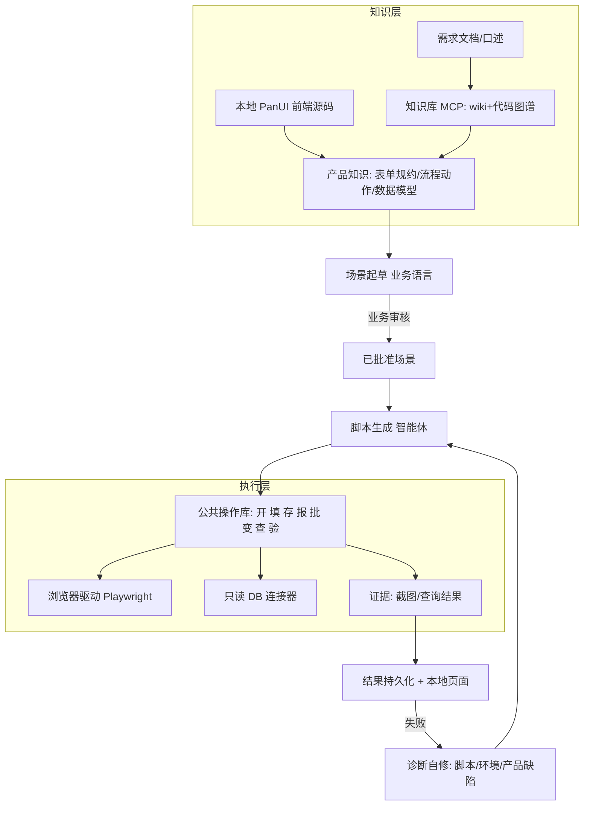

# IFC AI 自动化回归测试：项目设计（目标 / 需求 / 抽象 / 架构 / 计划）

> 取代上一版。上一版以企业定存为中心，容易做成"只对一个功能有效"。本版先定义**项目本身**，企业定存、银行授信额度变更只是**验证样本**，用来检验抽象是否成立，不用来驱动设计。

## 1. 项目目标
**目标：业务人员用自然语言描述真实业务场景，智能体就能在我们的 PanUI/OSP 系统上自动写出、跑通、修复回归脚本，并校对结果是否正确。业务人员不看代码。**

| 维度 | 要求 |
|---|---|
| 对象 | 业务功能（任意模块）的真实业务场景回归。**只做核心的、用户生产中天天会遇到的场景**，包括必要的核心异常（如余额不足被拦截、重复提交被拦截），不为凑数做穷举 |
| 使用者 | 业务/测试人员，通过智能体聊天使用 |
| 通用性 | 跨功能、跨项目、跨机器、跨人员；Windows 和 macOS 都真实可用 |
| 贴合性 | 基于我们 PanUI/OSP 的实际实现，不是通用开源框架 |
| 旧资产 | 本地已有自动化只参考，不使用；这次重写 |

**不做（现阶段）**：CI 集成、定时调度（页面预留，后续做）、与真实使用无关的边界值穷举、写 DB 造数、密钥管理。

## 2. 核心设计命题：高度抽象
业务各异，但在我们系统中**技术路径是同一类**。因此不按"功能"写代码，而按**"单据生命周期"**抽象。

### 2.1 单据生命周期模型（核心抽象）
PanUI 里几乎所有业务都是：对一张**表单/单据**做一系列**动作**，产生**状态变化和数据落地**。


每个业务场景 = 这几个**原语**的有序组合 + 每步之后的**检查点**。

| 原语 | 含义（业务语言） | 在 PanUI 上落地的抽象 |
|---|---|---|
| 开 | 进入某个功能的新增/详情/列表 | 菜单导航、打开单据、从列表选中某条 |
| 填 | 填写表头字段、表格行 | 按表单设计元数据定位字段与网格，按字段类型赋值（文本/下拉/日期/数值/弹窗选择/级联） |
| 存 | 保存，处理强控与提示 | 点工具栏按钮，捕获校验提示/弹窗 |
| 报 | 提交流程 | 流程提交动作，选择办理人 |
| 批 | 审批同意/驳回/退回 | 切换角色登录，待办处理，节点操作 |
| 变 | 变更、终止、撤回 | 对已生效单据发起变更；流程撤回、取回 |
| 查 | 列表查询、条件过滤 | 查询视图设置条件、读取结果行 |
| 验 | 校对结果 | 见 2.2 |

> 新功能 = 换一份"字段清单+业务规则+检查点"，原语不变。这是通用性的来源。

### 2.2 结果校对的三种证据（"验"）
业务人员要的是"结果对不对"，从三处交叉验证：
1. **界面**：字段值、状态、提示信息、表格行数据。
2. **查询**：系统内的查询视图/报表是否能查到、数值是否一致。
3. **数据库（只读）**：存值表记录、状态字段、下游生成的指令/凭证数量金额。支持 Oracle、信创库等，由首次运行时的配置决定。

每个场景至少一个业务检查点；没有检查点的脚本不算通过。

### 2.3 业务场景描述（给业务人员看的唯一产物）
自然语言，按业务写，不暴露字段 id 和选择器：
```
场景：银行授信额度变更-审批后额度生效
前提：已有生效的银行授信，额度 1000 万
步骤：财务发起额度变更，新额度 1500 万，填写变更原因；提交；复核员同意
检查点：
  - 授信额度查询里显示 1500 万
  - 变更记录里 变动前 1000 万 / 变动后 1500 万
  - 额度余额同步增加 500 万
```
业务人员只审：**步骤是否是真实用户会走的、检查点是否是真正关心的**。

## 3. 架构


### 3.1 分层职责
| 层 | 职责 | 是否业务相关 |
|---|---|---|
| 知识层 | 汇总可得的需求、知识库、源码、系统实际界面，形成对"该功能在我们系统怎么实现"的理解 | 是（每次不同） |
| 场景层 | 业务语言的场景与检查点 | 是 |
| 脚本层 | 每个场景一个脚本，只写业务步骤，调用公共库 | 是（由智能体生成） |
| **公共操作库** | 实现 8 个原语，对 PanUI 组件的操作细节全部封装在这里 | **否（项目核心资产）** |
| 驱动/证据/存储 | 浏览器、DB 连接、截图、结果持久化、页面 | 否 |

### 3.2 公共操作库的关键设计
- **元数据驱动**：字段、按钮、网格、流程节点从表单设计元数据与组件规约推导，不手写选择器。
- **组件适配注册表**：PanUI 的每一种组件（输入框、下拉、日期、弹窗选择、树选择、表格等）一个适配器。
- **核心库受保护（多人共用的关键约束）**：公共操作库是共享资产，**任何人的智能体都不得直接修改核心库**，否则会把已稳定的能力改坏。规则：
  1. 核心库只读、带版本号，随发布包分发，运行时校验文件完整性（被改动则报警并拒绝运行）。
  2. 遇到核心库未覆盖的组件或动作，智能体只能在**本地扩展层**（与核心库分开的目录）新增适配器，仅对本机生效，不覆盖核心同名适配器。
  3. 本地扩展要进入核心，必须走**提案**：智能体生成改动说明与样本证据，由维护者审核合入，并在**全部样本回归通过**后发新版本。
  4. 核心库自带"自测样本集"，每次发版前必须全部通过，以此防止改好的被改坏。
- **关键点**：通用性来自**适配器覆盖面**，所以先覆盖完整的组件集，再谈场景；稳定性来自**核心受保护 + 扩展层隔离 + 自测样本集**。

### 3.3 配置与运行（首次真正运行时才需要用户提供）
智能体在"首次运行"前通过对话收集，存入本机配置文件：
- 系统地址、登录账号、角色
- 数据库类型和只读连接信息
- 项目名、环境名

换项目 = 新配置，不改库。配置不进业务脚本。

### 3.4 结果与页面
- 每次运行保存：场景、环境、时间、四态结果（通过/失败/阻塞/无效）、失败步骤、截图、关键查询与 DB 结果。
- 本地简单页面：选环境选场景、手动启动、查看历史与对比；定时设置项预留。

## 3.5 产品级背景基线（项目必须内置，防止 AI 想象过头）
没有需求文档时，智能体必须先站在**统一的产品认知**上，否则容易把我们的系统想象成"功能很大、很智能"。基线随项目一起维护，作为智能体每次工作的**前置必读**。

### 产品是什么
- IFC 是**境外财资管理软件**，面向境外财资中心或类似职能公司。客户是 TOB，业务模式相对固定。
- 业务模块：账户管理、内部存款、授信管理、内部贷款、融资管理、结算管理、投资管理、外汇衍生品、资金计划、现金管理、现金流管理、资金监控、风险管理、会计引擎。
- 技术形态是**传统企业应用**：低代码平台（OSP/PanUI）上的 **表单 + 流程 + 查询 + 自动任务 + 数据库表**，不是智能推荐系统。

### 通用业务形态（跨模块共性，待探索阶段用证据校正）
| 共性 | 说明 |
|---|---|
| 角色 | 财资中心（操作员、复核员）、成员单位财务、系统管理员；数据权限按单位隔离 |
| 单据 | 基础资料 → 业务申请/办理单据 → 变更/终止/到期等后续单据，层级与编号有继承关系 |
| 流程 | 提交 → 节点审批 → 末节点同意后生效；可驳回、撤回 |
| 生效结果 | 写入业务存值表、更新状态、必要时**生成下游指令**（如转账指令）、计提与会计凭证 |
| 自动任务 | 日终、到期处理等定时任务，通常要求幂等 |
| 辅助 | 查询视图、回单/通知单打印、业务提醒、配置项 |

### 保守原则（硬规则）
1. **只相信证据**：每条关于产品行为的结论，必须能指向代码、配置、表结构、实际界面或业务确认之一；无证据一律标"未确认"。
2. **不假设"智能能力"**：不得假设系统会自动推荐、自动纠错、自动补全或自动联动，除非代码或界面明确存在（例如"利率自动带出"必须在表单配置或代码里找到依据）。
3. **不假设功能存在**：看不到的菜单、按钮、字段，不写进场景；怀疑存在时去核对，核对不了就追问。
4. **以最朴素的方式理解**：先按"表单填写、点按钮、流程流转、数据落库"这套机械过程理解，再看是否有特殊逻辑。
5. **场景里的预期必须来自业务或证据**，不得由智能体按常识推断结果。

### 基线怎么建
- 初稿来自：产品介绍、模块清单、已有文档中的共性（如企业定存 PRD、银行信贷设计）。
- 校正来自：探索阶段读源码、表结构、实际界面，逐条用证据确认或删除。
- 每个新项目用到的**项目差异**（定制菜单、定制字段、定制流程）单独记在该项目配置里，不污染基线。

> 无文档项目的工作方式：读基线 → 读该功能代码与表单配置 → 观察实际界面 → 追问业务 → 起草场景，让业务审。

## 4. 前期必做：探索阶段（先于任何场景）
这是你指出的关键。**在第一次要用户任何信息之前，智能体先把产品摸清楚**，输出"产品操作规约"。

| 探索项 | 来源 | 产出 |
|---|---|---|
| PanUI 组件全集 | `04.osp/ifc-6.5-react-webapp`（前端）与 `04.osp/osp-lcdp-parent`（平台后端）：`osp-react-basecomps/src/ui`（FormInput/Select/Table/Tabs/TreeSelect/Window…）、`osp-react-comps`、`ifc-react-comps` | 组件清单；每种组件的 DOM 结构、赋值/取值方式、事件 |
| 表单模型 | `osp-react-form-designer`、`osp-react-formbuilder` + 知识库「表单设计器配置路径」 | 表单元数据格式，字段/按钮/网格/分录如何对应到界面 |
| 流程动作 | `osp-react-flow/src/actions`：提交、回收、驳回、撤回、批量处理、委托、任务领取等动作 | 流程原语的动作映射、角色切换方式 |
| 查询视图 | `osp-react-queryview` | 查询、过滤、导出、读取结果 |
| IFC 业务代码 | 本地 `00.code`（各业务域）、`01.server`（IFCSpringService、ifc-db-update）及知识库代码图谱：存值表、状态字段、流程回调、升级脚本 | "验"原语如何查库；业务实际逻辑 |
| 业务模式 | 知识库 wiki（产品知识库、产品技术文档） | 境外资金业务在我们系统里的实现方式、术语、单据层级、权限矩阵 |

**探索产出（项目第一份交付物）**：`PanUI 产品操作规约`，本身是给智能体读的知识，也自然形成后续场景生成的依据。

### 知识来源分级（不能假设有文档）
很多项目没有详细需求、设计文档，甚至没有。因此知识来源按可得性分级，智能体逐级取用：

| 级别 | 来源 | 说明 |
|---|---|---|
| A | 需求/设计文档（如企业定存 PRD、银行信贷详细设计） | 有则最好，只是加速项 |
| B | **IFC 业务代码与表单配置、数据库表结构** | 没有文档时的主要依据，能还原字段、规则、状态流转、落库 |
| C | **系统实际界面**（探索性操作，只读观察菜单、表单、按钮） | 补足代码看不出的交互 |
| D | **向业务追问** | 前三者仍不清楚时持续追问，直到智能体能说清"这个功能在我们系统怎么实现、数据落哪、状态怎么流转" |

> 当前样本里企业定存、银行授信有文档，属于最好情况。**设计和验证必须同时用"没有文档只有代码"的功能来检验**，否则抽象会依赖文档。
> 以上各级都要在**第 3.5 节产品背景基线**的约束下使用。知识库 MCP 已验证可连通；本地 `04.osp`、`00.code`、`01.server` 都在探索范围。

## 5. 防止"只对一个功能有效"的验证方法
抽象是否成立，不是靠宣称，要靠**形态不同的样本**检验：

| 样本 | 形态覆盖 |
|---|---|
| 基础资料维护（如存款类型，选一个**无文档**的功能同样验证） | 简单表单：开、填、存、查 |
| 企业定存存入 | 带流程审批、数据生成下游指令 |
| 银行授信额度变更 | 对已生效单据的"变"、表格分录、额度联动、变更记录 |
| 带撤回/终止的场景 | 撤回、取回、驳回再提交 |
| 带表格分录的单据 | 网格行增删改 |

**通过标准**：在新增样本时，**公共操作库的改动只在新增组件适配器，原语和脚本结构不变**。如果每加一个功能就要改原语，说明抽象不对，要先返工设计再继续。

## 6. 增量需求的处理
- 智能体读知识库中该功能的**现有实现与历史设计**，得到基线业务路径。
- 把增量点（如新增字段）放进基线路径相应步骤，形成检查点。
- 需求不清楚就**持续追问**，直到智能体能说清"这个功能在我们系统里是怎么实现的、数据落在哪、状态怎么流转"。追问的是业务，不是配置。

## 7. 实施计划
| 阶段 | 内容 | 验收 |
|---|---|---|
| 0 探索 | 完成第 4 节全部探索，输出《PanUI 产品操作规约》草稿 | 你审阅规约能认同"智能体懂我们的系统了" |
| 1 公共库内核 | 8 原语 + 组件适配器注册表 + 元数据驱动 + 双平台适配 | 基础资料维护样本跑通 |
| 2 流程与变更 | 报/批/变/撤回，多角色切换 | 企业定存存入样本跑通 |
| 3 表格与联动 | 网格分录、额度类联动、查询校对、只读 DB 验证 | 银行授信额度变更样本跑通 |
| 4 结果与页面 | 持久化、本地页面、手动启动 | 能选择、运行、看历史 |
| 5 泛化验证 | 第 5 节全部样本 + 双平台实测 | 不改原语即可新增样本 |
| 6 场景起草能力 | 需求→业务场景起草、追问机制 | 用新需求回放 |

## 8. 风险
- **组件长尾**：PanUI 组件多、个别非规约 → 靠适配器注册表逐步覆盖，并如实标注"不支持清单"。
- **只读 DB 与前置数据**：不造数，前置数据靠界面操作建立，场景可能变长。
- **需求质量差**：靠追问和知识库补全，业务审核场景是最后一道关。
- **双平台**：路径、编码、驱动差异，需要两个系统真实跑过。

## 9. 需要你确认的只有这些
1. 同意本版"先探索、再抽象、再样本验证"的路线？
2. 核心库受保护机制（核心只读、本地扩展层、提案合入、自测样本集）是否符合你们多人共用的预期？维护者角色由谁担任？

路线、探索范围（含 IFC 代码）和 MCP 用法你已确认。我按需用 HTTP 直接调用知识库，不要求挂载。下一步直接开始**阶段 0 探索**，不会先向你要环境信息。
